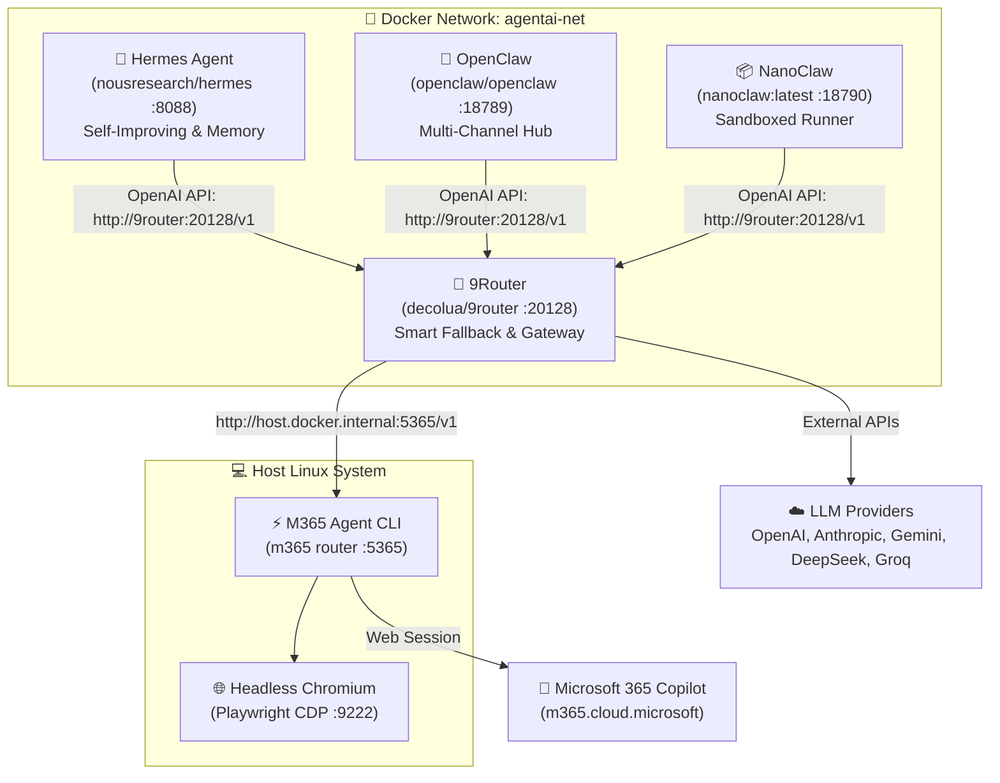
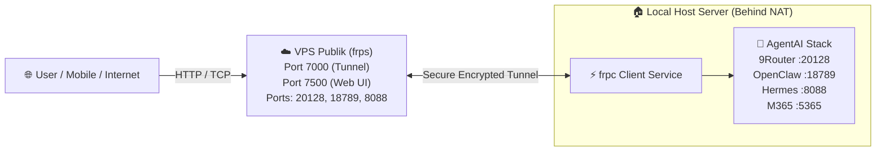

# 📘 Panduan Lengkap AgentAI Stack: 9Router, Hermes, OpenClaw, NanoClaw, M365 Copilot & FRP

Dokumen ini adalah panduan referensi arsitektur, integrasi, dan operasional untuk ekosistem AI Agent mandiri (*self-hosted*):
- **9Router**: Central AI Gateway & Fallback Router
- **Hermes Agent (Nous Research)**: Autonomous Self-Improving Agent & Long-Term Memory
- **OpenClaw**: All-in-One Multi-Channel Assistant & Automation Hub
- **NanoClaw**: Lightweight Container-Isolated Sandboxed Agent
- **M365 Copilot Model & Agent CLI**: Local Enterprise Agent, RPA & OpenAI-Compatible Router
- **FRP (Fast Reverse Proxy)**: High-performance reverse proxy untuk mengekspos service lokal di balik NAT ke publik via VPS.

---

## 🏗️ 1. Arsitektur & Topologi Sistem

Semua komponen bekerja dalam sebuah ekosistem terpadu. **9Router** bertindak sebagai *hub* penghubung sentral antara agen-agen otonom (**Hermes**, **OpenClaw**, **NanoClaw**) dengan berbagai penyedia model LLM, termasuk model gratis dari **M365 Copilot**.



---

## 🔀 2. 9Router (Intelligent AI Gateway)

### Peran Utama
**9Router** (`decolua/9router:latest`) adalah *smart proxy & gateway* yang menyediakan satu endpoint standar OpenAI-compatible (`http://localhost:20128/v1`) untuk puluhan provider LLM sekaligus.

### Fitur Kunci:
1. **3-Tier Smart Fallback Routing**:
   - **Tier 1**: Model premium / langganan utama (Claude Pro, OpenAI, Copilot).
   - **Tier 2**: Model ekonomis berbiaya rendah (DeepSeek, GLM, MiniMax).
   - **Tier 3**: Model gratis / free-tier community provider.
   - Jika quota atau rate-limit Tier 1 tercapai, request otomatis dialihkan ke Tier berikutnya tanpa memutus sesi agen.
2. **RTK Token Compression**: Kompresi lossless pada input CLI (seperti `git diff`, `cat`, output terminal) untuk menghemat konsumsi token hingga 40-70%.
3. **Multi-Account Round-Robin**: Rotasi otomatis beberapa API key dalam satu provider untuk menghindari batas RPM/TPM.

### Integrasi dengan Docker Agent:
Dalam `docker-compose.yml`, service agent mengarah ke 9Router melalui URL internal:
```env
OPENAI_BASE_URL=http://9router:20128/v1
OPENAI_API_KEY=router-key
```

### Akses Web Dashboard:
* URL: `http://localhost:20128`
* Konfigurasi API keys, routing rules, token usage monitoring, dan failover chain dapat diatur langsung melalui Web UI.

---

## 🧠 3. Hermes Agent (Nous Research)

### Peran Utama
**Hermes Agent** (`nousresearch/hermes-agent:latest`) adalah agen mandiri tingkat lanjut yang dirancang untuk **belajar secara mandiri (*self-improving*)** dan memiliki kurasi memori jangka panjang lintas sesi (*persistent cross-session memory*).

### Fitur Kunci:
1. **Curated Long-Term Memory**: Tidak sekadar menyimpan riwayat chat mentah, Hermes secara aktif merangkum pola instruksi, preferensi arsitektur, dan konteks proyek ke dalam direktori persisten `/opt/data`.
2. **Bundled Skills System (44 Built-in Skills)**:
   - `sdlc-review`, `test-driven-development`, `systematic-debugging`
   - `architecture-diagram`, `manim-video`, `p5js`
   - `computer-use`, `claude-code`, `codebase-inspection`, `simplify-code`
   - `google-workspace`, `microsoft-office`, `pdf`, `obsidian`
3. **S6-Overlay Process Supervision**: Menjalankan process manager terisolasi dengan dashboard mandiri.

### Web Dashboard & Kredensial:
* **Host Port**: `http://localhost:8088` (Internal container: `9119`)
* **Username**: `admin` *(dapat diubah di `.env` via `HERMES_AUTH_USER`)*
* **Password**: `admin123456` *(dapat diubah di `.env` via `HERMES_AUTH_PASS`)*

### Perintah CLI di Container:
```bash
# Buka sesi chat interaktif
docker compose exec hermes hermes chat

# Lihat daftar skill yang aktif (termasuk finops-cloud)
docker compose exec hermes hermes skills list

# Jalankan prompt FinOps multi-cloud
docker compose exec hermes hermes ask "Audit pemborosan cloud AWS dan OCI"
```

---

## 🐾 4. OpenClaw (Autonomous Assistant & Automation Hub)

### Peran Utama
**OpenClaw** (`ghcr.io/openclaw/openclaw:latest`) adalah *runtime agent personal* modular berskala penuh. Sangat cocok jika Anda membutuhkan asisten AI yang terhubung ke puluhan kanal perpesanan sekaligus.

### Fitur Kunci:
1. **Multi-Channel Chat Integration**: Terhubung langsung ke WhatsApp, Telegram bot, Slack bot, Discord, dan Webhooks.
2. **Gateway & Control UI**: Dashboard visual untuk memonitor percakapan, status kanal, dan automasi cron.
3. **Model-Agnostic Engine**: Mendukung format pesan standar dengan multi-model context handling.

### Akses Web Gateway & Control UI:
* **URL**: `http://localhost:18789`
* **Volume Data**: `./data/openclaw` dipetakan ke `/home/node/.openclaw` di dalam kontainer.

### Perintah CLI di Container:
```bash
# Menjalankan wizard konfigurasi dan onboarding kanal
docker compose exec openclaw node openclaw.mjs onboard

# Cek status kesehatan gateway dan koneksi kanal chat
docker compose exec openclaw node openclaw.mjs status

# Cek info skill FinOps di OpenClaw (Status: Ready)
docker compose exec openclaw node openclaw.mjs skills info finops-cloud

# Menjalankan satu turn instruksi agen FinOps langsung
docker compose exec openclaw node openclaw.mjs agent --message "Jalankan audit FinOps untuk AWS dan Azure"
```

---

## 📦 5. NanoClaw (Minimalist Sandboxed Agent Runner)

### Peran Utama
**NanoClaw** (`agentai/nanoclaw:latest`) adalah alternatif ultra-ringan dari OpenClaw yang fokus pada **keamanan berbasis isolasi kontainer (*OS-level container isolation*)**.

### Fitur Kunci:
1. **Strict Sandboxing**: Setiap eksekusi instruksi dibatasi pada direktori kerja `./data/nanoclaw` tanpa akses ke memori proses bersama atau filesystem host.
2. **Lean & Auditable**: Kode sumber TypeScript ramping berbasis runtime modern Node 22 dan Bun.
3. **Cocok untuk Edge / Server Minimalis**: Mengonsumsi resource RAM dan CPU paling kecil di antara agen lainnya.

### Akses & Perintah CLI di Container:
* **Host Port**: `http://localhost:18790`
* **CLI Command**:
  ```bash
  docker compose exec nanoclaw ncl --help
  docker compose exec nanoclaw ncl status
  ```

---

## ⚡ 6. M365 Copilot Model & Agent CLI

### Peran Utama
**Andi Pangeran M365 CLI** (`m365`) adalah agen Linux cerdas yang menghubungkan terminal Anda langsung ke akun enterprise **Microsoft 365 Copilot** (`m365.cloud.microsoft`), dengan kapabilitas Antigravity (setara `agy` / `claude` CLI), Browser RPA via Chrome DevTools Protocol (CDP), dan server OpenAI-compatible router.

### Keuntungan Utama:
* **Akses LLM Canggih Tanpa Biaya Token**: Menggunakan akun Microsoft 365 Copilot yang sudah ada tanpa perlu membayar tagihan API per-token ke OpenAI/Anthropic.
* **OpenAI-Compatible Router (`m365 router`)**: Menjalankan API proxy lokal di port `5365` yang dapat didaftarkan sebagai provider model di **9Router**.

### Model yang Disediakan oleh M365 Router:
1. `m365` — Model standar M365 Copilot dengan konteks lokal dan file project.
2. `m365-agent` — Mode otonom (eksekusi bash, perbaikan kode, dan manajemen file).
3. `m365-rpa` — Spesialis otomasi browser headless (CDP port 9222).
4. `m365-plan` — Antigravity planning mode (pembuatan rencana step-by-step terstruktur).

### Cara Menggunakan M365 CLI di Host:

```bash
# 1. Login pertama kali (mendukung URL dinamis Cloudflare Tunnel untuk SSH/PuTTY)
m365 login

# 2. Periksa status login & sesi browser
m365 status

# 3. Tanya langsung atau instruksi kode
m365 "Tolong analisa kode di folder ini"
m365 ask "Bagaimana cara optimasi konfigurasi docker compose?"

# 4. Mode perencanaan Antigravity
m365 plan "Migrasi database ke PostgreSQL"

# 5. Jalankan Router API untuk 9Router & Docker Agents
m365 router
```

---

## 🔗 7. Panduan Alur Integrasi (M365 Router ➡️ 9Router ➡️ Agents)

Berikut adalah langkah menghubungkan model M365 Copilot agar dapat digunakan oleh Hermes Agent, OpenClaw, dan NanoClaw:

### Langkah 1: Jalankan M365 Router di Host
```bash
m365 router
```
*Router akan aktif di `http://localhost:5365/v1`*.

### Langkah 2: Buka Dashboard 9Router
Buka browser Anda ke `http://localhost:20128`.

### Langkah 3: Tambahkan Provider Kustom di 9Router
1. Di menu **Providers / Models**, pilih **Add Custom OpenAI Provider**.
2. Masukkan parameter:
   - **Provider Name**: `M365 Copilot`
   - **Base URL**: `http://host.docker.internal:5365/v1`
   - **API Key**: `m365-local-key` *(bebas / dummy)*
   - **Models**: `m365`, `m365-agent`, `m365-plan`
3. Masukkan model `m365` ke dalam **Tier 1 Priority** di 9Router.

### Hasil:
Sekarang, saat **Hermes Agent** atau **OpenClaw** mengirimkan prompt ke 9Router (`http://9router:20128/v1`), 9Router akan mengarahkan request tersebut ke **M365 Router**, diproses oleh model Copilot secara gratis, dan dikembalikan ke agen dengan mulus!

---

## 🛠️ 8. Panduan Operasional Sehari-hari

| Tugas | Perintah |
| :--- | :--- |
| **Check & Auto-Install Docker/Compose** | `./check-docker.sh` |
| **Install via curl (Pilih Menu)** | `curl -fsSL https://raw.githubusercontent.com/andonebekasi/agentai/main/install.sh \| bash` |
| **Install di Host/PC lokal** | `./install.sh` |
| **Install AI CLIs (Gemini/Claude/Copilot)** | `curl -fsSL https://raw.githubusercontent.com/andonebekasi/agentai/main/install-ai-clis.sh \| bash` / `./install-ai-clis.sh` |
| **Login M365 Copilot (Andi Pangeran)** | `m365 login` |
| **Install FRP Server/Client via curl** | `curl -fsSL https://raw.githubusercontent.com/andonebekasi/agentai/main/install-frp.sh \| bash` |
| **Install & Setup FRP (lokal)** | `./install-frp.sh` |
| **Menjalankan seluruh stack** | `./start.sh` |
| **Mengecek status & RAM/CPU** | `./status.sh` |
| **Melihat log real-time** | `docker compose logs -f [service_name]` |
| **Restart satu service** | `docker compose restart [9router/hermes/openclaw/nanoclaw]` |
| **Stop stack (data aman)** | `./destroy.sh` |
| **Reset total beserta data** | `./destroy.sh --volumes` |

---

## 🌐 9. Integrasi FRP (Fast Reverse Proxy)

[FRP](https://github.com/fatedier/frp) memecahkan masalah umum pada server on-premise, homelab, atau PC lokal: **tidak memiliki IP publik statis atau berada di balik CGNAT / firewall ISP**.

### Diagram Alur Koneksi FRP:


### Konfigurasi Port Mapping:
Secara default, [frp/frpc.toml](file:///home/andi/script/poc-aws/agentai/frp/frpc.toml) memetakan service berikut:
- **Port 20128**: 9Router Dashboard & OpenAI API
- **Port 18789**: OpenClaw Gateway Control UI
- **Port 8088**: Hermes Agent Web UI
- **Port 18790**: NanoClaw Service
- **Port 5365**: M365 Copilot Router

### Manajemen Service FRP:
- Cek status: `sudo systemctl status frpc` (pada client) atau `sudo systemctl status frps` (pada server VPS).
- Restart: `sudo systemctl restart frpc`
- Log: `sudo journalctl -u frpc -f`

---

## ❓ 10. Solusi Masalah Umum (Troubleshooting)

1. **Dashboard Hermes meminta username/password?**
   - Gunakan `admin` / `admin123456`. Anda bisa menggantinya di file [.env](file:///home/andi/script/poc-aws/agentai/.env) pada variabel `HERMES_AUTH_USER` dan `HERMES_AUTH_PASS`.
2. **Port 8080 atau 3000 bentrok?**
   - Port Hermes telah dipetakan ke **8088** dan NanoClaw ke **18790**, sehingga port 8080 (`zap-web`) dan 3000 (`open-webui`) yang sudah ada di sistem tetap aman.
3. **M365 Router tidak bisa diakses dari dalam kontainer Docker?**
   - Pastikan flag `extra_hosts: ["host.docker.internal:host-gateway"]` aktif di `docker-compose.yml`, dan panggil melalui `http://host.docker.internal:5365/v1`.
